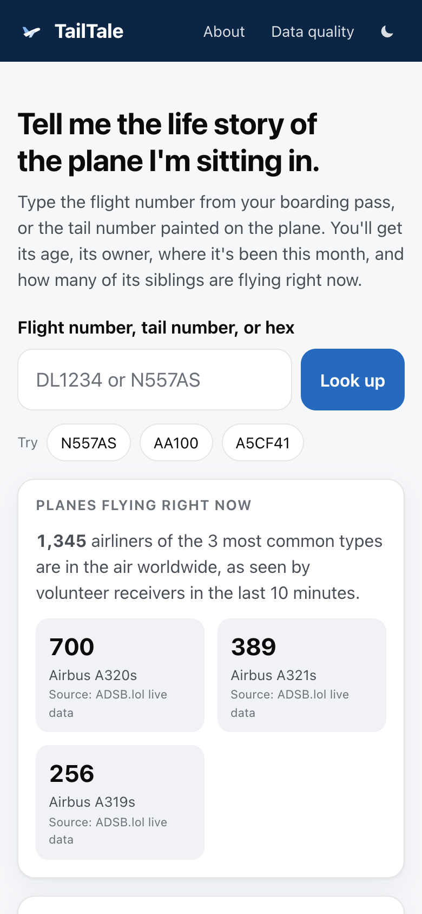
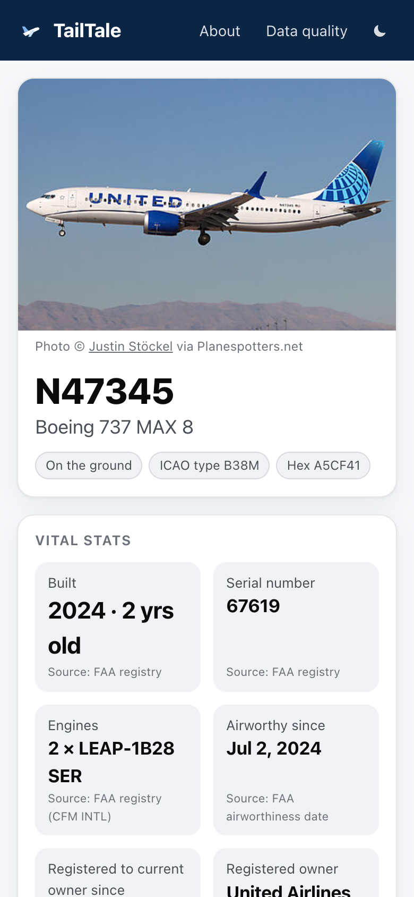
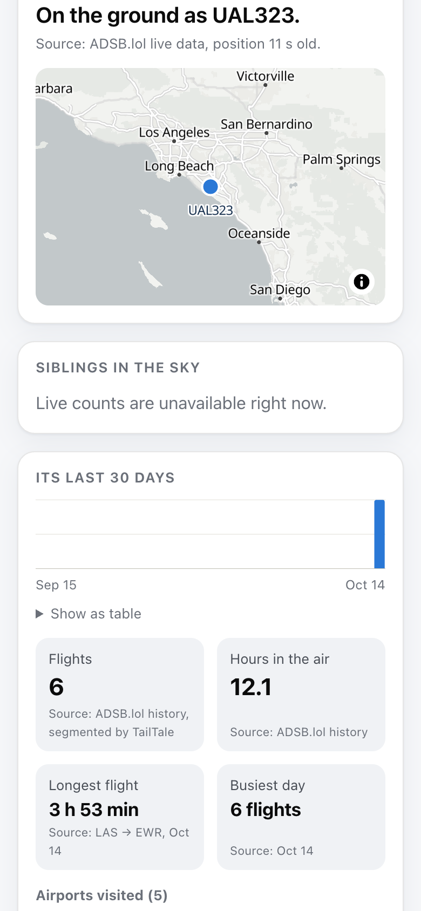
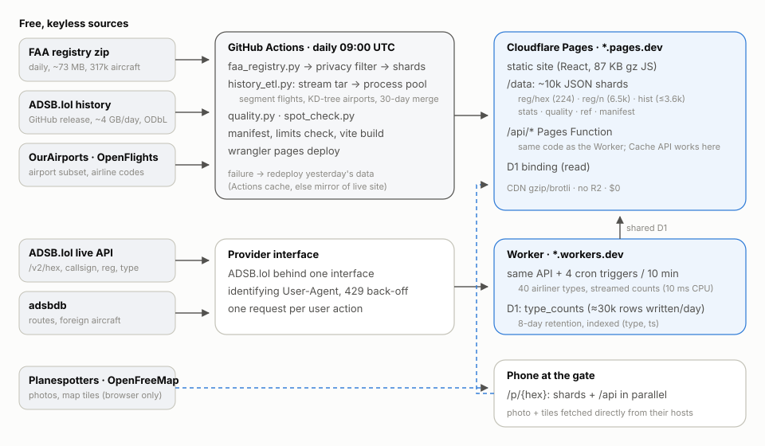

# TailTale

**Tell me the life story of the plane I'm sitting in.**

Type a flight number (`DL1234`), a tail number (`N557AS`) or a transponder hex (`A5CF41`) and get a shareable card
about that exact airframe: what it is, how old it is, who owns it, where it has been this month, and how many of its
siblings are flying right now.

Runs every day with zero manual steps and **$0**: GitHub Actions + Cloudflare Pages, Workers and D1 on the free plans.
No paid tiers, no card, no custom domain, no OpenSky, no R2.

<p>
  
  
  
  
</p>

## Architecture



**Static first.** Everything that changes daily is a static JSON file on the CDN; only truly live data goes through
code at request time.

| Piece | What it does | Where |
|---|---|---|
| `pipeline/faa_registry.py` | FAA Releasable Aircraft DB (317k aircraft) → privacy filter → 224 hex shards + 6,476 N-number shards + per-model age histograms | GitHub Actions |
| `pipeline/history_etl.py` | Streams yesterday's ~4 GB ADSB.lol archive straight into `tarfile`, segments ~34k US aircraft tracks into flights, merges a rolling 30 days into ≤3,600 shards | GitHub Actions (~2.5 min locally) |
| `pipeline/quality.py`, `spot_check.py` | Daily data-quality report and route spot check | GitHub Actions |
| `worker/` | API: resolve input → hex, live state, siblings count + 7-day trend, routes; cron every 10 min counts 40 airliner types into D1 | Cloudflare Worker + the same code as a Pages Function |
| `web/` | React app, mobile first, 87 KB gzipped JS, MapLibre lazy-loaded | Cloudflare Pages |

A lookup: the browser calls `/api/resolve?q=DL1234`, which maps `DL` → `DAL` and asks ADSB.lol for `DAL1234`
**and** its regional partners (`EDV1234,SKW1234,RPA1234`) in one request. It then fetches, in parallel, the registry
shard `/data/reg/hex/A5C.json`, the history shard `/data/hist/A5CF.json`, `/api/live/{hex}`,
`/api/siblings/{type}`, `/api/route/{callsign}`, and the Planespotters photo (directly, per their terms). Every card
section loads and fails independently.

### Why the API runs twice

The spec puts the API on a `*.workers.dev` Worker with `caches.default`. Cloudflare's docs say the Cache API is a
no-op on `workers.dev` and works on Pages Functions (`*.pages.dev`). So the same handler (`worker/src/app.ts`) is
deployed both ways: the Worker owns the cron and D1 writes, and the site calls the same-origin Pages Function, where
caching actually works and no CORS is needed.

## The data pipeline, in five minutes

1. **Discover.** GitHub API → `adsblol/globe_history_{YEAR}` → the day's `…-planes-readsb-prod-0` release. Its tar is
   split mid-file into `.tar.aa` (2.0 GB) + `.tar.ab` (~1.9 GB).
2. **Stream.** A `ConcatStream` joins the parts over HTTP, resuming with `Range` on dropped connections, and feeds
   `tarfile.open(mode="r|*")`. Nothing touches disk. Members outside the US block `A00001–ADF7C7` and non-ICAO `~`
   addresses are skipped; LADD/PIA aircraft (`dbFlags & 12`) keep only a `blocked` stub.
3. **Segment.** A process pool (with backpressure, so the reader can't run ahead) parses each gzip trace and:
   drops points implying > 700 kt; treats `"ground"` or < 50 kt near an airport as on the ground; splits takeoffs and
   landings; counts a low (< 3,000 ft AGL) last point near an airport followed by 20+ minutes of silence as a landing;
   closes any other 30+ minute airborne silence as **incomplete** (never guessed); drops flights under 5 minutes.
   Airports come from a `cKDTree` over 3D unit vectors of ~6,300 OurAirports fields, with an 8 km radius.
4. **Merge.** Yesterday's flights are appended to the previous shards (from the Actions cache, else the live site),
   days older than 30 drop off, and re-runs of a day are idempotent. A down site aborts instead of wiping history.
5. **Publish.** Manifest, Pages-limit check (< 19,000 files, each < 24 MiB), `vite build`, `wrangler pages deploy`.
   If any ETL step fails, the site is redeployed with yesterday's data and the run is marked failed.

Full schema: [`pipeline/SCHEMA.md`](pipeline/SCHEMA.md). Upstream field notes: [`docs/upstream_notes.md`](docs/upstream_notes.md).

### Results on a real day (2026-10-14)

67,631 traces read · 33,891 US aircraft · 82,309 flights · 3,431 privacy opt-outs · 2,034 outlier points dropped ·
147 s end to end on a laptop, 167 MB peak memory. Airliners: 62% of flights have both airports matched. Route spot
check (25 airliners, 93 flights): 100% leg continuity over 68 legs; published callsign route tables agree with our
departure airport 68% and arrival 72% of the time, and are themselves often stale (see `notebooks/`).

Notebook findings: the 757-200 is the oldest common US airliner type (median 32 years); 21% of US airliners are
registered to a bank, trust or lessor; business jets opt out of tracking at 27% vs 7% for piston aircraft.

## Free-tier budget

| Limit | Use |
|---|---|
| Pages: 20,000 files, 25 MiB each | ~10,300 files, largest 2.4 MB (checked before every deploy) |
| Workers: 100k req/day, 10 ms CPU | heavy work is precomputed; type counts never `JSON.parse` 650 KB bodies; the cron is split over 4 triggers |
| D1: 100k rows written/day | ≈ 30k/day (40 counts + pruning every 10 min, with indexes) |
| GitHub Actions | public repo; one ~10–20 min job per day |

## Privacy and honesty

* Individual, partnership and co-owner names and **all addresses** are removed in the pipeline before any file is
  written (tests scan every output file). Only organizations are named.
* FAA LADD/PIA aircraft: type-level information only. No position, no history, no photo.
* Every number on the page shows its source. Partly observed flights are labelled, not filled in.
* Footer on every page: *For curiosity only. Not for navigation, safety, or operational decisions.*

## Running it locally

```bash
# pipeline (Python 3.12, uv)
cd pipeline && uv sync
uv run python faa_registry.py                     # → out/data/reg
uv run python history_etl.py --day 2026-10-14     # → out/data/hist, stats, quality/run.json (needs GITHUB_TOKEN for API limits)
uv run python quality.py --day 2026-10-14
uv run pytest -q --cov=history_etl

# worker (Node 22)
cd worker && npm ci && npm test
npx wrangler d1 migrations apply tailtale --local && npx wrangler dev --test-scheduled

# web
cd web && npm ci && ln -s ../../out/data public/data && npm run dev   # proxies /api to wrangler dev on :8787
npm test && npm run build && npm run e2e
```

## Deploying your own copy

1. Fork, then create a Cloudflare API token with **Pages: Edit, Workers Scripts: Edit, D1: Edit, Account Settings: Read**.
2. `CLOUDFLARE_API_TOKEN=… CLOUDFLARE_ACCOUNT_ID=… scripts/setup-cloudflare.sh` creates the D1 database, the Pages
   project and the Worker, writes their IDs into `wrangler.toml`, and sets the GitHub secrets and variables.
3. Commit, push, and run **Actions → Daily data + deploy** once (optionally with `backfill: 7`).

## Repository layout

```
pipeline/   Python ETL, tests, SCHEMA.md         worker/   API + cron + D1 migrations (vitest)
web/        React app (vitest, Playwright)        data/     airline overrides (reference data only)
notebooks/  coverage_and_gaps, fleet_insights (+ build_notebooks.py)     docs/     upstream notes, diagram, launch posts
.github/workflows/  ci.yml · daily.yml · worker.yml
```

## Credits

Data from ADSB.lol (ODbL), the FAA, Planespotters.net, adsbdb, OurAirports, OpenFlights (ODbL) and
OpenFreeMap/OpenStreetMap. See [ATTRIBUTION.md](ATTRIBUTION.md). Code: MIT. Derived history data: ODbL.
